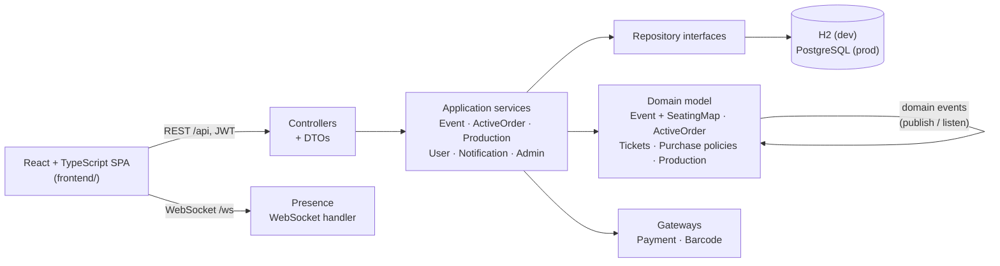

# TicketPlatform

An event-ticketing platform where production companies publish events with seating maps, set purchase and discount policies, and sell tickets, and where buyers reserve seats, check out, and receive barcoded tickets. It was built over one semester (April–June 2026) by a team of 8 as a university software-engineering project.

> This is a personal copy of the team repository, with full commit history.
> Credentials that were committed during development have been replaced with `CHANGE_ME_*` placeholders throughout the history.

## Features

- **Events and seating maps.** Assigned-seat sections and standing areas, configured per event.
- **Reservations and checkout.** Seats are held in an active order, then paid for and turned into tickets with unique barcodes.
- **Concurrency safety.** Per-event locking plus optimistic version checks, so two buyers can never book the same seat and concurrent edits to an event don't overwrite each other.
- **Purchase policies.** Composable AND/OR rules such as age limits and minimum/maximum tickets per order, plus event discount policies.
- **Production companies.** Owners and managers with enforced permissions, company purchase history, and event management.
- **Cancellations and refunds.** Cancelling an event refunds each order individually, with rollback if a payment step fails partway.
- **Notifications.** In-app notifications for orders, refunds, and cancellations, plus WebSocket presence tracking to detect users who leave unexpectedly.
- **System admin.** Admin console and a configurable initial-state loader for seeding the system.

## Tech stack

| Layer | Technology |
|---|---|
| Backend | Java 21, Spring Boot 3.3 (Web, Security, Data JPA, WebSocket), JWT (jjwt) |
| Persistence | Spring Data JPA / Hibernate; H2 in development, PostgreSQL in production |
| Frontend | React, TypeScript, Vite, React Router |
| Testing | JUnit 5, Mockito, Spring Boot Test, Vitest; JaCoCo coverage |
| CI | GitHub Actions (Maven build and tests on every push and PR to `main`) |

## Architecture

The backend follows a layered, domain-driven structure. Domain aggregates talk to each other through domain events instead of calling each other directly.



| Path | What lives there |
|---|---|
| `src/main/java/.../Controllers` | REST endpoints and request/response DTOs |
| `src/main/java/.../application` | Use-case services, plus the payment and barcode gateway interfaces |
| `src/main/java/.../domain` | Aggregates (`event`, `ActiveOrders`, `tickets`, `Production`, `User`, `notification`, `systemAdmin`) and their domain events |
| `src/main/java/.../infrastructure` | JPA repositories, in-memory repos for tests, gateways, WebSocket, logging, config validation |
| `src/main/java/.../init` | Parser for the initial-state seed file |
| `frontend/src/pages` | Auth, events, orders/checkout, production company, policies, notifications, admin |
| `src/test` | Unit, integration, acceptance, and concurrency tests (81 test classes) |

## Running it

**Requirements:** JDK 21 and Node 18+. The Maven wrapper is included.

```bash
# Backend: dev profile, in-memory H2, seeded with test data (http://localhost:8080)
./mvnw clean spring-boot:run "-Dspring-boot.run.profiles=dev"

# Frontend: Vite dev server, proxies /api and /ws to the backend
cd frontend && npm install && npm run dev

# Tests
./mvnw test
cd frontend && npm test
```

The H2 console is at `http://localhost:8080/h2-console`. Before running anywhere other than locally, replace every `CHANGE_ME_*` value in `src/main/resources/application*.properties` with your own secrets. For the `prod` profile, also point `spring.datasource.url` at your own PostgreSQL instance.

See [docs/SETUP.md](docs/SETUP.md) for profile configuration and the seed-file format.

## Development process

- **Team:** 8 developers working in parallel on separate domain areas over about 10 weeks.
- **Workflow:** every change went through a feature branch and a pull request into `main`, with 170 merged. Conflicts between assignees working on the same aggregates were resolved on the branch before merging.
- **Planning:** work was split into GitHub issues and per-person tasks.
- **Quality gates:** GitHub Actions builds and runs the full test suite on every PR. Tests follow a GIVEN/WHEN/THEN naming convention and cover unit, acceptance, and concurrency levels. JaCoCo coverage reached 88% instructions and 80% branches.
- **AI usage:** LLM assistance was logged per feature in [llm_usage.md](llm_usage.md), as the course required.

## My contributions

I'm Maayan Dotan (`maayandot` in the history). I worked across the backend and frontend, with a focus on correctness under concurrency and reliability of the order lifecycle:

- **Double-booking prevention.** I wrote the concurrency integration test suite that exposed race conditions in seat reservation, then fixed them with per-event locking and optimistic version checks in the event repository.
- **Order lifecycle reliability.** Refund rollback on cancellation or payment errors, and consistency when a large cancellation fails midway.
- **Domain features.** Composite purchase policies and barcode generation and integration.
- **Persistence.** JPA/Hibernate mappings for order history and notifications.
- **Permissions.** Manager permissions enforced end to end.
- **Configuration.** Validation tests for config files.
- **Test quality.** Coverage work and test-convention standardization.

`git log --author=maayandot` lists the individual commits.
